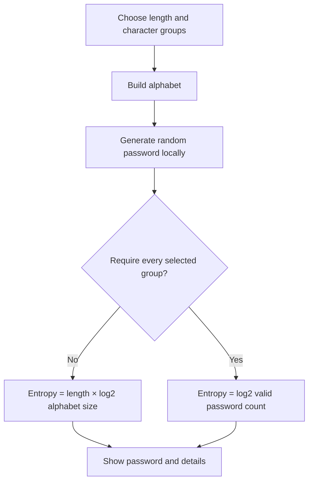

# Exact Entropy Password Generator

A local, browser-based password generator that creates random passwords and displays the calculated entropy for the selected generation rules.

## What it does

- Generates passwords locally in the browser
- Uses `crypto.getRandomValues()` for cryptographically suitable randomness
- Lets you choose:
  - password length
  - lowercase letters
  - uppercase letters
  - digits
  - ASCII symbols
  - whether every selected character group must appear at least once
- Shows:
  - alphabet size
  - entropy in bits
  - estimated search space
  - calculation model

No password, setting, or entropy value is sent to a server.

## How to use

Download or clone the repository, then open the HTML file in a modern browser.

No build step, server, package manager, or internet connection is required.

## Entropy model

The entropy value is calculated from the generator rules, not guessed from the final password.

Without required character groups:

```text
H = length × log2(alphabet size)
```

When every selected character group must appear at least once, the valid password space is smaller. In that case, the app counts the valid password space using inclusion-exclusion and calculates:

```text
H = log2(number of valid passwords)
```



## Entropy guide

The entropy tooltip gives a rough orientation:

- `<64 bit`: low
- `64–79 bit`: limited
- `80–111 bit`: solid for many practical attacks
- `112–127 bit`: high
- `128–191 bit`: very high
- `192–255 bit`: extremely high
- `≥256 bit`: beyond usual symmetric security levels; usually limited by other factors

These ranges are a practical guide, not a certification.

## Security notes

This tool only calculates entropy for passwords it generates.

If you manually change a generated password, the displayed entropy no longer applies.

The password field is read-only for this reason.

Use a password manager to store generated passwords.

## Browser support

A modern browser with support for `crypto.getRandomValues()` is required.

## Contributing

[Contributions are welcome!](https://github.com/MacSteini/exact-entropy-password-generator/blob/main/CONTRIBUTING.md "Contributions are welcome!")

## Licence

This project uses the [MIT Licence](LICENCE "MIT Licence"). You may use, change, and distribute it in compliance with the licence terms.
